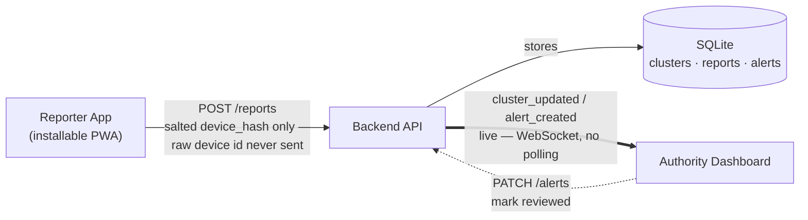
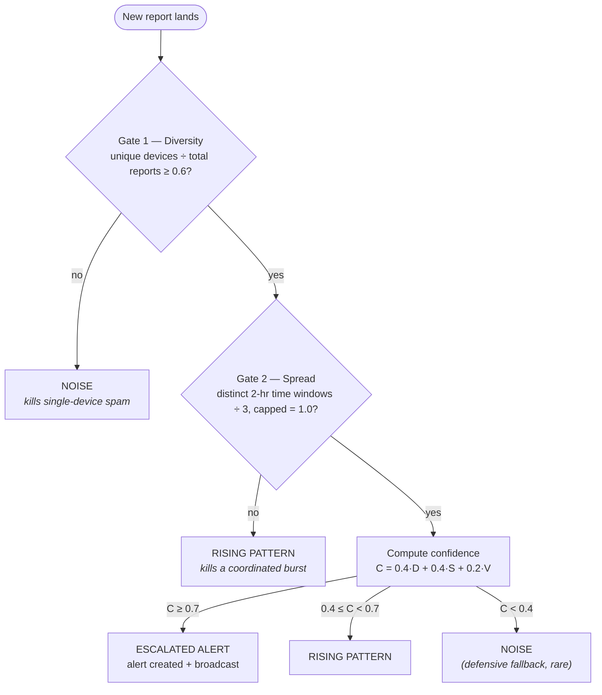

# CX1001 — "The Warning Sign Everyone Walked Past"

**MUSA CodeX 2026 · Women Safety & Social Impact track · Team Midnight Meows**

Anonymous, location-based safety reporting with an anti-gaming scoring
engine that tells a genuine pattern apart from spam or a coordinated flood —
automatically, before it ever reaches a human.

---

## The problem

Make a safety-reporting tool too open, and it gets flooded with fake
alerts. Make it too strict, and real warning signs get dismissed as noise.
Somewhere in the middle, an actual pattern — someone being followed home,
night after night — gets ignored, because nobody could tell the difference
between a genuine crisis and a coordinated troll attack.

CX1001 is built around one idea: a report only becomes an alert once the
system has *earned* the right to be confident about it — not because
enough people clicked a button, but because the shape of the reporting
itself looks like a real pattern rather than an attack on the system.

## What it is

Three pieces, working together:

| Component | Role |
|---|---|
| [`cx1001-api/`](cx1001-api) | **Backend.** Fastify + SQLite. Ingests reports, buckets them into location clusters, runs the anti-gaming scoring engine, and pushes live updates over WebSocket. |
| [`cx1001-reporter/`](cx1001-reporter) | **Reporter app.** An installable, offline-first PWA ("SafeSignal") — tap to report anonymously in under 5 seconds. No login, no name, no phone number, anywhere. |
| [`cx1001-dashboard/`](cx1001-dashboard) | **Authority dashboard.** A live map of report clusters, color-coded by how confident the system is, with a fully standalone mock mode for demos with zero backend. |

Each has its own README with full run instructions, its exact API/data
contracts, and the reasoning behind its implementation choices. This file
is the map of how they fit together.

## Run it

```bash
# terminal 1 — backend
cd cx1001-api
npm install
npm run seed     # loads two demo scenarios (see below)
npm run dev       # http://localhost:4000, ws at /ws

# terminal 2 — reporter app
cd cx1001-reporter
npm install
npm run dev       # http://localhost:5173

# terminal 3 — authority dashboard
cd cx1001-dashboard
npm install
npm run dev:live  # http://localhost:5174, against the real backend
```

Open the reporter at `http://localhost:5173`, tap "Report something here,"
and watch it land on the dashboard at `http://localhost:5174` live — no
page refresh, pushed over a websocket the instant the backend processes it.

Don't want to stand up the backend at all? `cd cx1001-dashboard && npm run
dev` runs the dashboard standalone against six simulated clusters, with a
mock websocket that nudges a rising cluster toward escalation every ~8
seconds using the *real* scoring formula — good for a demo with zero setup.

## Architecture



One report's whole round trip is three boxes and four labeled edges.
There's no message queue, no auth service, no fourth component hiding
anywhere — the entire design effort went into what happens inside the
Backend API box before anything touches the database.

### The scoring engine

This is the actual differentiator. Every new report to a cluster
re-triggers this whole evaluation from scratch — never an incremental
patch — and it's a sequence of **gates**, not a single weighted formula:



- **D — diversity** = unique `device_hash`es ÷ total reports in the
  cluster. Below 0.6, the cluster is `noise` and nothing else is even
  computed. This is what stops one device (or a handful) flooding a
  single location — no amount of volume buys past this gate.
- **S — spread** = distinct 2-hour time windows touched ÷ 3, capped at
  1.0. Below 1.0, the cluster is `rising_pattern`, permanently, no matter
  how many reports pile in. This is what stops a coordinated burst: thirty
  devices reporting inside one 10-minute window have perfect diversity but
  zero spread, because they can't fake elapsed real time.
- **V — volume** = `min(1, log2(1+n) / log2(21))`, a log-scaled report
  count that caps out around 20 reports — a tiebreaker, never the primary
  signal, and the last thing computed.

Only once both gates pass does confidence get calculated at all:
`C ≥ 0.7` escalates to a real `Alert`, broadcast over the websocket
immediately; `0.4–0.7` stays `rising_pattern`; below `0.4` falls back to
`noise` (a defensive case that shouldn't normally trigger once both gates
have already passed). `cx1001-api/test/anti-gaming.test.ts` is the proof:
automated tests for exactly these three scenarios — a single device
flooding one spot, a 30-device coordinated burst, and a genuine slow-build
pattern — asserting the engine lands on the right state every time.

## Demo data

`npm run seed` (in `cx1001-api`) loads two scenarios used throughout the
demo and the dashboard's default view:

- **"Station Corridor"** — 10 reports from 8 distinct devices, spread
  across 4 time windows over 5 simulated days. Clears both gates,
  confidence ≈ 0.88 → `escalated_alert`.
- **"Market Square"** — 30 reports from 30 distinct devices, all inside
  one 10-minute burst. Clears the diversity gate, fails the spread gate →
  capped at `rising_pattern`, confidence 0, never escalates.

## Privacy, by construction

- No login, no name, no phone number — no field for one exists anywhere
  in either app.
- A device is identified only by `SHA-256(random_local_id + app_salt)`,
  computed on-device. The raw ID never leaves the phone; a low-key
  settings option lets anyone regenerate it, severing all future reports
  from their past activity as far as the backend can tell.
- The backend never logs an IP address and never persists anything beyond
  the documented `Report` shape.
- The one free-text field in the whole system — an optional "Other"
  category detail, capped at 500 characters — carries an explicit,
  visible warning not to include your own name or anyone else's
  identifying details.
- Cluster data exposed to authorities is always aggregated (counts,
  histograms, category breakdowns) — a device hash is never returned by
  any endpoint that reaches the dashboard.

## Hardening against abuse

Two gates above defend the *scoring* against gaming, but a public,
login-free ingestion endpoint has its own attack surface, independent of
scoring:

- **Per-device and per-IP rate limits** (5 req/60s and 20 req/60s
  respectively) — the IP-keyed limit specifically catches a single script
  rotating through many forged `device_hash` values, which the per-device
  limit alone can't see. Both are ephemeral, in-memory counters, never
  logged or persisted.
- **Timestamp clamping** — a client-claimed report timestamp is trusted up
  to 6 hours in the past (enough to cover the reporter app's real
  offline-queue-then-sync delay); anything further out is silently
  reinterpreted as "now" for scoring. This closes the obvious exploit of
  scripting a fake multi-day pattern in a single HTTP burst, without ever
  rejecting a legitimately-delayed offline report.

What's still open, deliberately: `PATCH /alerts/:id` has no
authentication, and a `device_hash` is still self-asserted — a
sufficiently motivated attacker who scripts the API directly (not the
real app) can still forge distinct-looking devices. Closing either needs
a real credential story (a login system for authorities, or signed
reports), which is a product decision with real UX cost, not a drop-in
fix. See `cx1001-api/README.md` for the full writeup.

## Project structure

```
cx1001-api/         Fastify + better-sqlite3 backend
  src/
    db/              schema + connection (swap point for Postgres later)
    models/          Report / Cluster / Alert types + repositories
    services/        ingestion (validation, rate limits, timestamp clamp),
                      scoring (the gate engine), clustering, alerts
    routes/          HTTP endpoints
    ws/              websocket broadcast hub
  scripts/           seed-demo-data.ts
  test/              vitest suites, including anti-gaming.test.ts

cx1001-reporter/     Vite + React + TypeScript PWA ("SafeSignal")
  src/
    lib/             IndexedDB queue, device hash (+ insecure-context
                      fallbacks), geohash, background sync
    components/      the entire UI — one big tap target, a category
                      sheet, an optional detail box, a settings popover

cx1001-dashboard/    Vite + React + TypeScript + react-leaflet + Recharts
  src/
    lib/             real + mock data sources behind one interface,
                      live-location hook, backend-contract normalizers
    components/      map, markers, sidebar, detail panel, charts
    fixtures/        the six-cluster mock dataset
```

## Tech stack

- **Backend**: Node.js, TypeScript, Fastify, zod, better-sqlite3, ws, vitest
- **Reporter**: Vite, React, TypeScript, vite-plugin-pwa, `idb` (IndexedDB), Leaflet
- **Dashboard**: Vite, React, TypeScript, react-leaflet, Recharts, native WebSocket

No API keys, no external services, no cloud dependency — everything above
runs entirely on `localhost`.
